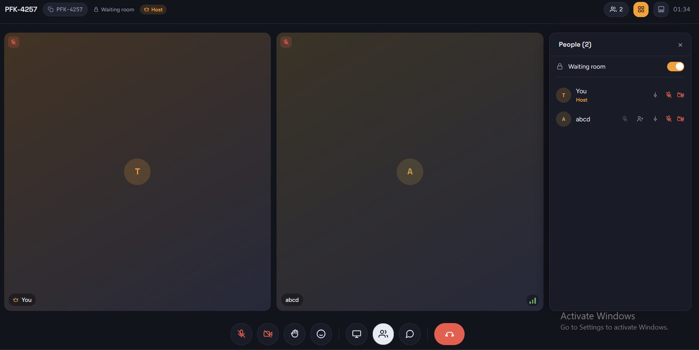
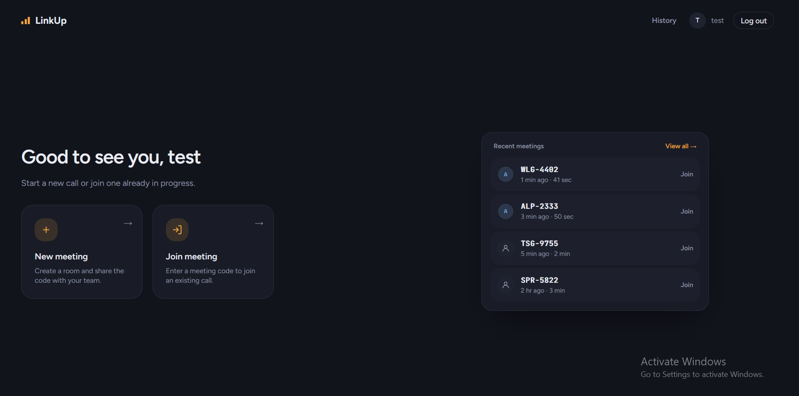
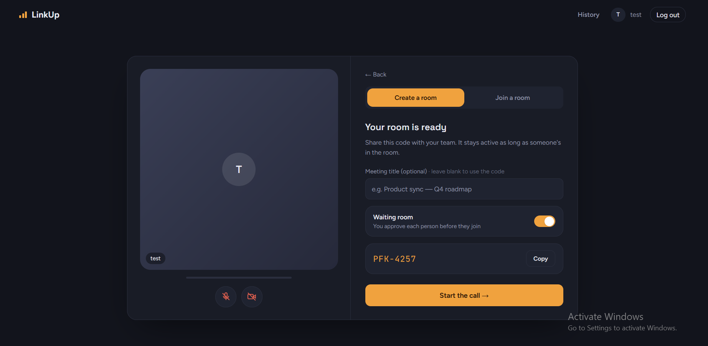
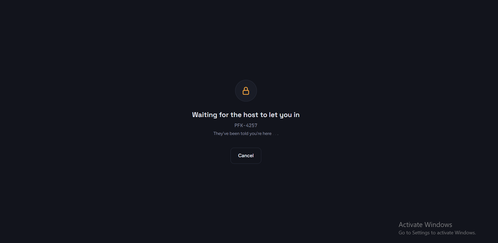
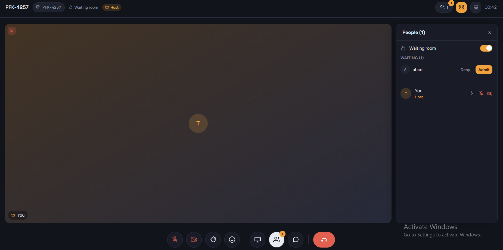
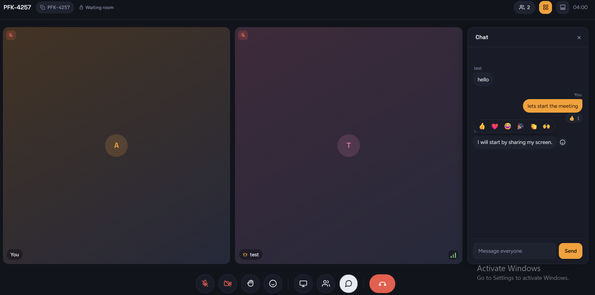
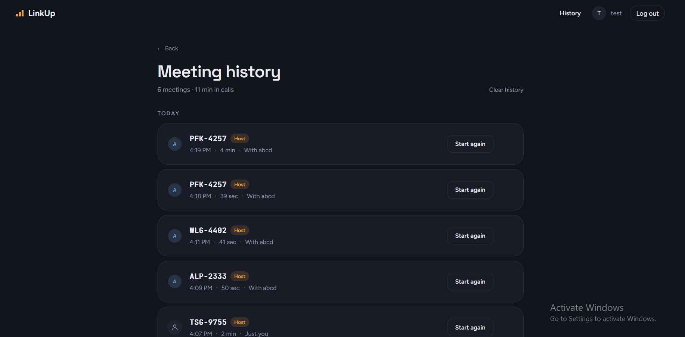
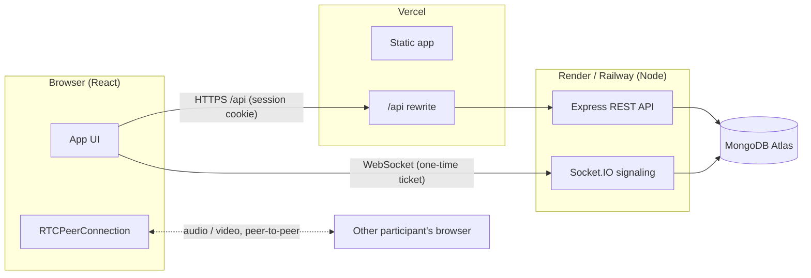
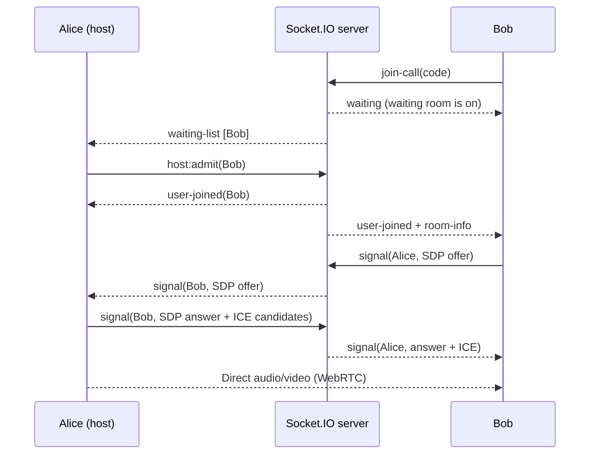

<div align="center">

# LinkUp

**Peer-to-peer video meetings in the browser: create a room, share the code, start talking.**

Built from scratch with **WebRTC** for audio/video, **Socket.IO** for signaling, **React** on the front end and **Node / Express / MongoDB** on the back end.

[**Live demo**](#) · [Features](#features) · [How it works](#how-it-works) · [Security](#security) · [Run it locally](#getting-started) · [Deploy](#deployment)




</div>

---

## Contents

- [Features](#features)
- [Screenshots](#screenshots)
- [How it works](#how-it-works)
- [Security](#security)
- [Tech stack](#tech-stack)
- [Project structure](#project-structure)
- [Getting started](#getting-started)
- [Environment variables](#environment-variables)
- [API reference](#api-reference)
- [Socket events](#socket-events)
- [Deployment](#deployment)
- [Limitations and roadmap](#limitations-and-roadmap)
- [What I learned](#what-i-learned)

---

## Features

**Meetings**
- Create a room and get a short code (e.g. `LKP-7291`); give it a title, or the code is used as the title
- Join with a code or a pasted link. Links work even when you're logged out: you log in, then land on the join screen with the code filled in
- Lobby with camera preview and mic level before you join
- Grid and speaker views, pin anyone, screen sharing with automatic presenter view

**Host controls**
- **Waiting room** (optional, chosen when creating the meeting, can be toggled mid-call): guests wait until the host admits or denies them
- Mute a participant, remove a participant (they can't rejoin that meeting), end the meeting for everyone
- If the host leaves, the host role passes to the next person automatically

**Chat and reactions**
- In-call chat with history for people who join late
- **Reactions on messages** (👍 ❤️ 😂 🎉 👏 🙌) with counts and who reacted
- **Typing indicator**: "Priya is typing…"
- Floating emoji reactions and raise-hand

**Meeting history**
- Every call you join is recorded by the server: title, time, duration, who was there, and whether you hosted
- "Recent meetings" on the home page and a full history page with rejoin and delete

**Connection quality indicator**
- Signal bars on every participant, computed from WebRTC's own statistics (`RTCPeerConnection.getStats()`): round-trip time, packet loss, and whether the connection is direct or relayed

---

## Screenshots

| Home | Lobby with waiting room |
|:---:|:---:|
|  |  |

| Guest in the waiting room | Host: admit, mute, remove |
|:---:|:---:|
|  |  |

| Chat with reactions | Meeting history |
|:---:|:---:|
|  |  |

---

## How it works

### Architecture



- The **REST API** (accounts, sessions, history) is reached through a **Vercel rewrite**, so it lives on the same site as the app and the httpOnly session cookie stays first-party.
- The **Socket.IO server** handles signaling, room state, chat and host controls. WebSockets can't go through the rewrite, so the browser first gets a **one-time, 60-second ticket** from the API and connects with it.
- **Audio and video never touch the server.** Browsers send them directly to each other over WebRTC.

### Joining a call (signaling)



The newcomer creates an `RTCPeerConnection` to everyone already in the room (a **mesh**). Offers, answers and ICE candidates travel through the `signal` event, and the server only relays them between people in the **same** room.

### STUN, TURN and why there is no TURN server

Most devices sit behind a router (NAT) and don't know their public address.

- **STUN** answers "what's my public address?". It costs almost nothing, so LinkUp uses Google's public STUN servers. Most calls (roughly 80–90%) connect **directly** this way.
- **TURN** is a relay for networks that block direct connections (strict corporate firewalls, some mobile networks). Every byte of video goes through it, so it costs real bandwidth and money.

LinkUp is a learning and portfolio project, so it **ships without a TURN server**. Calls work on most home and office networks; on very strict networks they may connect without video. TURN support is already built in: set `VITE_TURN_URL`, `VITE_TURN_USERNAME` and `VITE_TURN_CREDENTIAL` and the browser uses it automatically, only when a direct path fails.

The connection-quality tooltip shows which path each call actually took: *Direct (same local network)*, *Direct peer-to-peer (found via STUN)* or *Relayed through a TURN server*.

---

## Security

| Area | What LinkUp does |
|---|---|
| **Sessions** | Login creates a random 256-bit session secret stored in an **httpOnly, SameSite=Lax** cookie (Secure in production). JavaScript can't read it, so an XSS bug can't steal it. Nothing about the login is kept in `localStorage`. |
| **Session storage** | Only a **SHA-256 hash** of each secret is stored in MongoDB, so a database leak doesn't expose live sessions. Sessions expire after 30 days of inactivity (MongoDB TTL index). |
| **Logout** | Logout deletes the session **on the server**, not just in the browser. "Log out everywhere" ends every session for the account. Each device has its own session. |
| **Passwords** | Hashed with **bcrypt** (cost 12). 8–72 characters; longer passwords are refused instead of being silently truncated by bcrypt's 72-byte limit. |
| **Brute force** | Rate limits: 10 failed logins per 15 minutes per IP + username, 5 sign-ups per hour per IP, and a general API limit. |
| **User enumeration** | "No such user" and "wrong password" return the same status, message **and timing** (a dummy bcrypt comparison runs when the user doesn't exist). |
| **Input validation** | Usernames are trimmed and lowercased (3–30 characters, `a-z 0-9 . _ -`), names ≤ 40 characters. Only real strings are accepted, which blocks NoSQL operator injection like `{"$ne": null}`. |
| **CSRF** | SameSite cookies, plus an **Origin check** that rejects state-changing requests from any site other than `CLIENT_URL`. |
| **CORS** | API and socket only accept the configured frontend origin(s) in production. |
| **Socket auth** | Sockets require a single-use ticket (valid 60 s) issued to a logged-in session. Display names come from the account, so nobody can impersonate someone in chat. |
| **Room isolation** | Signaling messages are only relayed between members of the same room. Host actions are checked on the server, so a modified client can't mute or remove people. |
| **Headers** | `helmet` on the API; CSP, `X-Frame-Options`, `nosniff`, `Referrer-Policy` and `Permissions-Policy` on the frontend (see `frontend/vercel.json`). |
| **Errors** | Clients get generic messages; details stay in server logs. Password hashes and session secrets are never logged. |

---

## Tech stack

| Layer | Technology |
|---|---|
| Frontend | React 19, Vite 7, React Router 7, Tailwind CSS 4 |
| Real-time | WebRTC (`RTCPeerConnection`, `getStats`), Socket.IO client |
| Backend | Node.js, Express 5, Socket.IO 4 |
| Database | MongoDB with Mongoose 9 |
| Security | bcrypt, httpOnly cookie sessions, express-rate-limit, helmet, cookie-parser |
| Hosting | Vercel (frontend), Render or Railway (backend), MongoDB Atlas |

---

## Project structure

```
LinkUp/
├── backend/
│   └── src/
│       ├── app.js                        # Express setup, security middleware, startup
│       ├── controllers/
│       │   ├── auth.controller.js        # register, login, logout, me, socket ticket
│       │   ├── history.controller.js     # meeting history
│       │   └── SocketManager.js          # rooms, signaling, waiting room, host controls, chat
│       ├── lib/
│       │   ├── session.js                # cookie sessions (hashed, sliding expiry)
│       │   ├── tickets.js                # one-time socket tickets
│       │   └── validate.js               # input rules
│       ├── middleware/
│       │   ├── auth.js                   # requireAuth
│       │   └── security.js               # rate limits, origin check, CORS origins
│       ├── models/                       # User, Session, Meeting
│       └── routes/                       # /api/v1/auth, /api/v1/users
│
└── frontend/
    ├── vercel.json                       # /api rewrite, SPA fallback, security headers
    └── src/
        ├── context/AuthContext.jsx       # who is logged in (asks /auth/me)
        ├── lib/                          # api client, history hook, formatting
        └── components/pages/
            ├── landing/                  # landing + home (recent meetings)
            ├── auth/                     # log in / sign up
            ├── home/Setup.jsx            # lobby: preview, title, waiting room
            ├── call/Call.jsx             # the meeting room
            └── history/History.jsx       # meeting history
```

---

## Getting started

**Requirements:** Node.js 20+ and a MongoDB database (the free [MongoDB Atlas](https://www.mongodb.com/atlas) tier is enough).

```bash
git clone https://github.com/Sarvesh0457/Linkup.git
cd Linkup
```

**Backend**

```bash
cd backend
npm install
cp .env.example .env      # then set MONGO_URL
npm run dev               # http://localhost:3001
```

**Frontend** (in a second terminal)

```bash
cd frontend
npm install
cp .env.example .env      # defaults point at localhost:3001
npm run dev               # http://localhost:5173
```

In development Vite forwards `/api` to the backend, just like Vercel does in production. To try a call on one machine, open the app in a normal window and a private window and log in with two different accounts.

---

## Environment variables

### Backend (`backend/.env`)

| Variable | Required | Description |
|---|---|---|
| `MONGO_URL` | yes | MongoDB connection string |
| `PORT` | no | Port to listen on (default `3001`; hosts set it for you) |
| `NODE_ENV` | production | Set to `production` so the session cookie is `Secure` (HTTPS only) |
| `CLIENT_URL` | production | Your frontend URL, e.g. `https://linkup.vercel.app` (comma-separate several). Unset = any origin, for development only |
| `TRUST_PROXY` | production | Number of proxies in front of the app, so rate limits see real client IPs. With Vercel → Render it is `4` (Vercel, Cloudflare and two Render routers); check that `/api/v1/health` shows your own IP |
| `EDGE_IP_HEADER` | Render | `cf-connecting-ip`. The address that reached the host's edge; it can't be faked, so it backs a second rate limit for people calling the backend directly |

### Frontend (`frontend/.env`)

| Variable | Required | Description |
|---|---|---|
| `VITE_SOCKET_URL` | yes | Backend address for the WebSocket, e.g. `https://linkup-api.onrender.com` |
| `VITE_DEV_API` | dev only | Where `npm run dev` forwards `/api` (default `http://localhost:3001`) |
| `VITE_TURN_URL` / `_USERNAME` / `_CREDENTIAL` | no | Optional TURN server |

---

## API reference

All routes are under `/api/v1`. Authenticated routes use the session cookie.

| Method | Route | Auth | Description |
|---|---|:---:|---|
| `POST` | `/auth/register` | | Create an account and log in. Body: `{ name, username, password }` |
| `POST` | `/auth/login` | | Log in. Body: `{ username, password }` |
| `POST` | `/auth/logout` | | End this browser's session |
| `POST` | `/auth/logout-all` | ✓ | End every session for this account |
| `GET` | `/auth/me` | ✓ | Current user `{ name, username }` |
| `POST` | `/auth/socket-ticket` | ✓ | One-time ticket for opening the socket |
| `GET` | `/users/history?limit=50` | ✓ | Your meetings, newest first |
| `DELETE` | `/users/history/:id` | ✓ | Remove one meeting from your history |
| `DELETE` | `/users/history` | ✓ | Clear your history |
| `GET` | `/health` | | Uptime check (also shows the IP the server sees) |

---

## Socket events

| Event | Direction | Purpose |
|---|---|---|
| `join-call` | client → server | Join or create a room `(code, { title, waitingRoom, mic, cam })` |
| `waiting` / `join-denied` | server → client | Held in the waiting room / not let in (`denied`, `removed`, `ended`) |
| `room-info` | server → client | Title, start time, host, waiting-room setting |
| `user-joined` / `user-left` | server → room | Participants changing |
| `signal` | both | WebRTC SDP offers/answers and ICE candidates |
| `peer-state` | both | Mic, camera, hand and screen-share state |
| `chat-message` / `chat-react` / `chat-reactions` | both | Chat, message reactions |
| `typing` | both | Typing indicator |
| `reaction` | both | Floating emoji reactions |
| `waiting-list` | server → host | Who is waiting |
| `host:admit` / `host:deny` / `host:mute` / `host:remove` / `host:end` / `host:waiting-room` | host → server | Host controls (checked on the server) |
| `host-changed` / `force-mute` / `removed` / `meeting-ended` | server → client | Results of host actions |

---

## Deployment

The frontend goes to **Vercel**, the backend to **Render** (or Railway), the database to **MongoDB Atlas**. All have free tiers.

### 1. Database: MongoDB Atlas
1. Create a free cluster and a database user.
2. Under **Network Access**, allow your backend host. On free tiers whose IPs change, `0.0.0.0/0` is the practical choice; the strong password protects it.
3. Copy the connection string; it becomes `MONGO_URL`.

### 2. Backend: Render (or Railway)
1. New **Web Service**, root directory `backend`, build `npm install`, start `npm start`.
2. Environment: `MONGO_URL`, `NODE_ENV=production`, `CLIENT_URL=https://<your-app>.vercel.app`, `TRUST_PROXY=4`, `EDGE_IP_HEADER=cf-connecting-ip`.
3. Deploy and note the URL, e.g. `https://linkup-api.onrender.com`. Check `https://…/api/v1/health`.

> Render's free tier sleeps after 15 minutes without traffic; the first request afterwards takes about 30 seconds.

### 3. Frontend: Vercel
1. In `frontend/vercel.json` (and `frontend/public/_redirects` if you use Netlify), replace `YOUR-BACKEND.onrender.com` with your backend's address.
2. Import the repo in Vercel, root directory `frontend`. Vite is detected automatically.
3. Environment: `VITE_SOCKET_URL=https://linkup-api.onrender.com`.
4. Deploy, then make sure `CLIENT_URL` on the backend matches the final Vercel URL exactly (no trailing slash).

### Production checklist

- [ ] `NODE_ENV=production` on the backend (Secure cookies)
- [ ] `CLIENT_URL` set to the exact frontend URL (CORS and the Origin check)
- [ ] `TRUST_PROXY` set, and `/api/v1/health` shows **your** IP, not a proxy's
- [ ] Backend address replaced in `vercel.json` / `_redirects`
- [ ] `VITE_SOCKET_URL` set on Vercel
- [ ] MongoDB Atlas network access configured; strong database password
- [ ] Everything served over **HTTPS**: browsers only allow camera and mic on secure pages
- [ ] `.env` files are **not** committed (they're in `.gitignore`)
- [ ] Log in, start a call from two devices and check the connection-quality tooltip

---

## Limitations and roadmap

**Known limitations**
- **Mesh topology:** every participant sends a stream to every other one, so quality drops beyond about 5–6 people. Larger meetings need an SFU (e.g. mediasoup or LiveKit).
- **No TURN server** by default (see [above](#stun-turn-and-why-there-is-no-turn-server)).
- **Single server instance:** room state lives in memory. Scaling out would need the Socket.IO Redis adapter and a shared store for tickets.

**Ideas for later**
- Recording with `MediaRecorder`
- Breakout rooms, polls
- Automated test suite in CI (the backend is already tested end-to-end against an in-memory MongoDB during development)

---

## What I learned

- **WebRTC fundamentals:** offer/answer negotiation, ICE candidates, why NAT makes peer-to-peer hard, and what STUN and TURN each solve
- **Reading `getStats()`** to measure round-trip time and packet loss, and to see which network path a connection actually uses
- **Real-time state with Socket.IO:** rooms, server-authoritative host controls, waiting rooms, and keeping clients in sync through reconnects
- **Web security in practice:** httpOnly cookie sessions vs. tokens in `localStorage`, CSRF and SameSite, rate limiting, timing-safe login, NoSQL injection, and the cross-site cookie problem when frontend and backend live on different domains

---

<div align="center">

Made by **[Sarvesh](https://github.com/Sarvesh0457)** · If you found this useful, a ⭐ is appreciated

</div>
